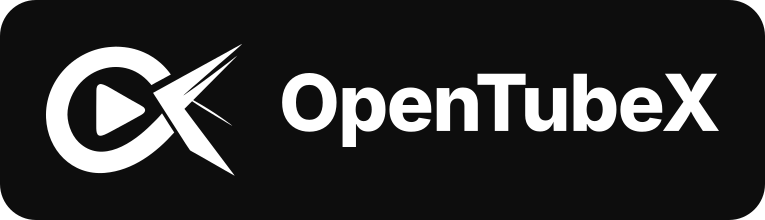
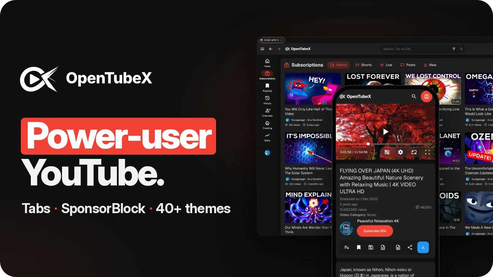
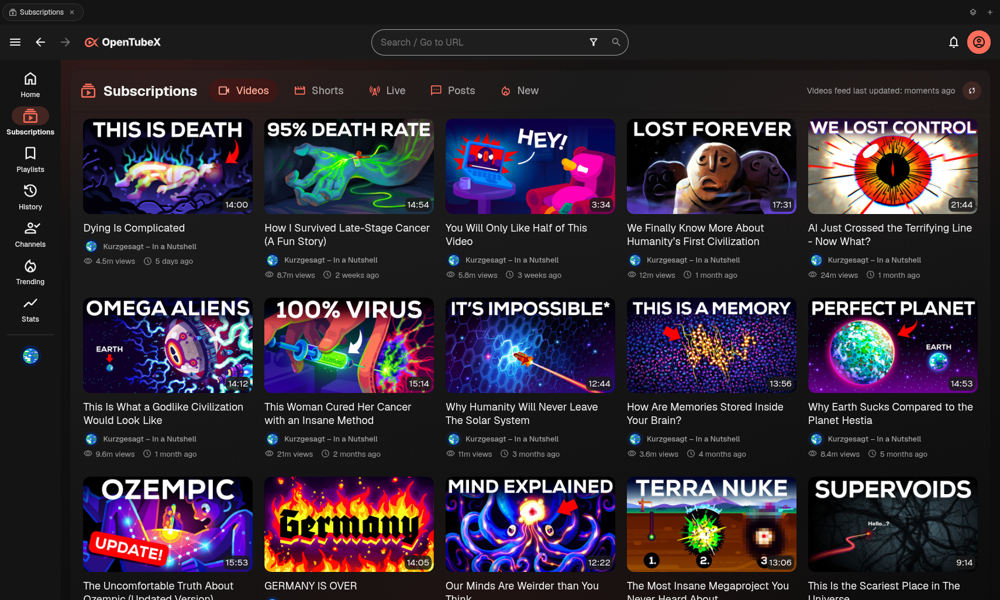
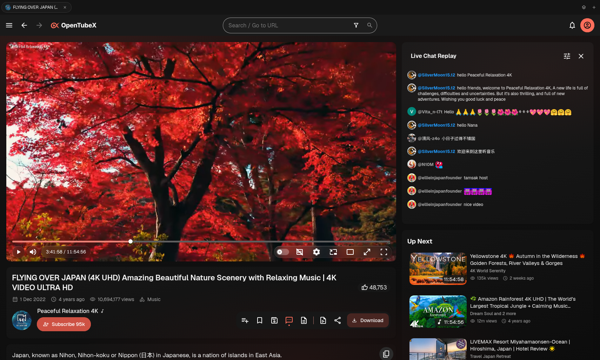
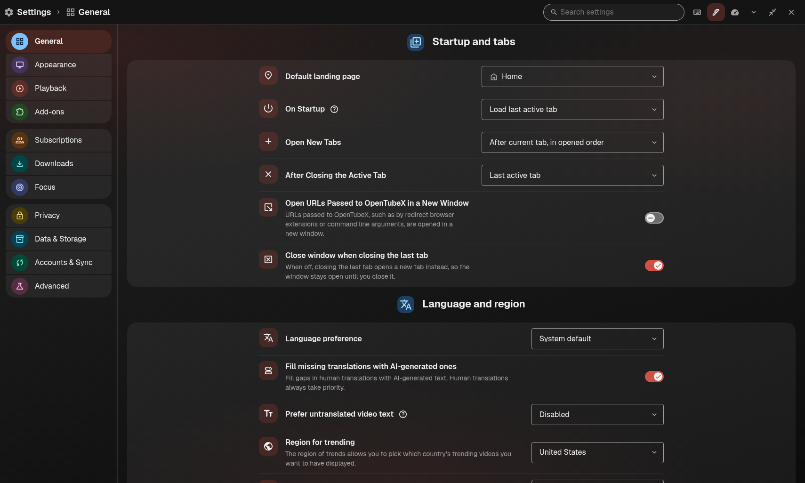

 

OpenTubeX is an open-source, highly customizable, privacy-focused YouTube client.
It runs on Windows 10 and later, macOS 13 and later, Linux, and Android 8.0 and later.
Builds for iOS and iPadOS 17.4 and later are experimental, and you can [host the web app yourself](https://opentubex.org/docs/self-hosting/).
Features differ between platforms.

It originated as a fork of [FreeTube](https://github.com/FreeTubeApp/FreeTube)
and is independently developed and supported. It is not affiliated with,
endorsed by, maintained by, or supported by the FreeTube project.

 

  

  
  
  
  
  
  

  
  

  <a href="https://alternativeto.net/software/opentubex/about/?utm_source=badge&amp;utm_medium=referral">
    <picture>
      <source media="(prefers-color-scheme: light)" srcset="https://alternativeto.net/static/badges/badge-wide-light.svg">
      <source media="(prefers-color-scheme: dark)" srcset="https://alternativeto.net/static/badges/badge-wide-dark.svg">
      
    </picture>
  </a>

  
  
  
  
  
  
  
  

  
  
  

  
   
  <a href="https://youtu.be/cKilnnScH9U">▶ Watch the promo · 24 seconds</a>

> [!NOTE]
> OpenTubeX is currently in Beta. While it should work well for most users, there are still bugs and missing features that need to be addressed.
>
> If you have an idea or if you found a bug, please submit a [GitHub issue](https://github.com/OpenTubeX/OpenTubeX/issues/new/choose) so that we can track it.  Please [search the existing issues](https://github.com/OpenTubeX/OpenTubeX/issues?q=is%3Aissue+sort%3Arelevance-desc) before submitting to prevent duplicates!

## ✨ Why OpenTubeX?

OpenTubeX plays YouTube videos without ads, and you don't need a Google account.
Subscriptions, playlists and history stay on your device unless you turn on sync.

- **Feed.** Sort subscriptions into profiles and choose, per channel, whether its videos, Shorts, live streams or posts appear. You can cap how many videos a channel adds to your feed each day. Optional recommendations rank unwatched videos on your device, based on what you watch and the feedback you give.
- **Playback.** Save speed and quality per channel, remap keyboard shortcuts, skip silent parts and loop a section with A-B repeat. SponsorBlock skips the segment categories you pick, except on channels you exempt.
- **Tabs.** Videos open in tabs, and the mini player keeps playing while you switch between them. You can queue videos, and the desktop app restores your tabs when you reopen it.
- **Interface.** Pick a theme or make your own, reorder the navigation and pin the settings you change often to Quick Settings. The Home page can show subscriptions, videos you haven't finished, playlists and more.
- **Sync.** Sync is off by default. When you turn it on, your data is end-to-end encrypted, so the sync server can't read it. The [privacy policy](https://opentubex.org/privacy/#desktop-and-mobile-apps) lists what each option shares.
- **History.** Charts show your daily and weekly watch time. You can search your history and set how long OpenTubeX keeps it.

## 📸 Screenshots

| The main OpenTubeX window |
| --- |
| <picture> <source media="(prefers-color-scheme: light)" srcset="docs/screenshots/OpenTubeX1-light.png"> <source media="(prefers-color-scheme: dark)" srcset="docs/screenshots/OpenTubeX1-dark.png">  </picture> |

| Watching a video |
| --- |
| <picture> <source media="(prefers-color-scheme: light)" srcset="docs/screenshots/OpenTubeX2-light.png"> <source media="(prefers-color-scheme: dark)" srcset="docs/screenshots/OpenTubeX2-dark.png">  </picture> |

| Settings |
| --- |
| <picture> <source media="(prefers-color-scheme: light)" srcset="docs/screenshots/OpenTubeX3-light.png"> <source media="(prefers-color-scheme: dark)" srcset="docs/screenshots/OpenTubeX3-dark.png">  </picture> |

## 🚀 Features

* Cast to Google Cast, FCast and DLNA devices
* Download videos, audio, subtitles and playlists, and download new uploads from channels you pick automatically
* Play videos from other sites, and follow channels on Twitch, SoundCloud, PeerTube, Rumble and Odysee without an account
* Follow RSS and Atom feeds next to your YouTube subscriptions
* Translate captions, show a second caption track and follow along in a transcript panel
* See dislike counts with Return YouTube Dislike and replace clickbait titles and thumbnails with DeArrow
* Hide channels and phrases with block lists, and hide channels on the community-maintained [AiSList](https://github.com/Override92/AiSList) of AI-generated content
* Set daily watch time and Shorts limits, break and bedtime reminders, and parental controls
* Search app actions, settings and your library from a command palette with <kbd>Ctrl</kbd>/<kbd>Cmd</kbd> + <kbd>K</kbd>
* Control the app with a gamepad
* Load videos with the built-in extractor, an Invidious instance or your own Yattee server, and route traffic through a proxy such as Tor
* Sign in to YouTube if you want to comment, rate videos or keep subscriptions and playlists in sync with your account
* Import from YouTube Takeout and LibreTube, and back up all your data to one ZIP file
* Play in the background and add home screen widgets on Android and iOS
* Open YouTube links from your browser with an [extension](#browser-extensions)

[See all features on the OpenTubeX website](https://opentubex.org/extra-features/).

## ⚙️ How does it work?
OpenTubeX uses a built-in extractor to request data and videos directly from YouTube. The [Invidious API](https://github.com/iv-org/invidious) can be used instead; depending on the video proxy setting, media requests may still go directly to YouTube. OpenTubeX does not use YouTube's official API.

OpenTubeX does not load the standard YouTube website or its page JavaScript, which reduces the browser-based tracking surface. It does not hide network requests: YouTube, an Invidious operator, or an optional service may still observe request metadata, including your IP address unless a proxy is used. See the [privacy policy](https://opentubex.org/privacy/#privacy-and-threat-model) for the complete threat model.

> [!IMPORTANT]
> Use a VPN or Tor to hide your IP address from YouTube and Invidious instances.

## 🧩 Browser extensions

These extensions open YouTube links in OpenTubeX. They don't work with the Linux portable builds. If an extension doesn't work with OpenTubeX, open an issue in this repository, not in the extension's.

[LibRedirect](https://libredirect.manerakai.com/) [3.5.0](https://github.com/libredirect/browser_extension/releases/tag/v3.5.0) and later redirect YouTube links to OpenTubeX automatically. Select OpenTubeX as the frontend in the extension's Services settings. Install it from [Mozilla Add-ons](https://addons.mozilla.org/firefox/addon/libredirect/) for Firefox-based browsers or from the [developer's website](https://libredirect.manerakai.com/docs.html#chromium-install) for Chromium-based browsers.

[RedirectTube](https://github.com/stankiewiczmichal/RedirectTube) [2.0.0 (26071)](https://github.com/stankiewiczmichal/RedirectTube/releases/tag/26071) and later add toolbar and context menu buttons that open a video in OpenTubeX. You can also turn on automatic redirects in its settings. Install it from [Mozilla Add-ons](https://addons.mozilla.org/firefox/addon/redirecttube/) for Firefox-based browsers or from the [Chrome Web Store](https://chromewebstore.google.com/detail/redirecttube/jpbaggklodpddjcadlebabhiopjkjfjh) for Chromium-based browsers.

## 📦 Download links
### Official downloads

  

> [!CAUTION]
> Only download OpenTubeX from the official sources listed here. Third-party download sites repackage our builds and often host outdated versions. One of them, YasDL, is on [FMHY's unsafe sites list](https://fmhy.net/unsafe) for uploading software with malware. To check a file from GitHub Releases, compare its SHA-256 checksum with the digest GitHub shows next to it on the release page.

* [GitHub Releases](https://github.com/OpenTubeX/OpenTubeX/releases)
* [OpenTubeX Website](https://opentubex.org/downloads/)
* Windows: [WinGet](https://github.com/microsoft/winget-pkgs/tree/master/manifests/o/OpenTubeX/OpenTubeX) (`winget install OpenTubeX.OpenTubeX`) 
* Windows: [Scoop bucket](https://github.com/OpenTubeX/scoop-bucket) (`scoop bucket add opentubex https://github.com/OpenTubeX/scoop-bucket`, then `scoop install opentubex/opentubex`), with [installation instructions](https://opentubex.org/downloads/#install-scoop).
* macOS: [Homebrew tap](https://github.com/OpenTubeX/homebrew-tap) (`brew install --cask opentubex/tap/opentubex`), with [installation and update instructions](https://opentubex.org/downloads/#install-homebrew).
* Debian / Ubuntu: [APT repository](https://apt.opentubex.org/)
* Fedora / Enterprise Linux: [COPR repository](https://copr.fedorainfracloud.org/coprs/d3sox/opentubex/) or [RPM repository](https://rpm.opentubex.org/)
* openSUSE: [RPM repository](https://rpm.opentubex.org/)
* Arch Linux / Arch Linux ARM: [Arch repository](https://arch.opentubex.org/)
* Flatpak: [OpenTubeX remote](https://flatpak.opentubex.org/), [Flatpark](https://flatpark.org/apps/org.opentubex.OpenTubeX/), and [source code](https://github.com/OpenTubeX/flatpak)
* Snap: [Snap Store](https://snapcraft.io/opentubex) (`sudo snap install opentubex --beta`), [installation instructions](https://snap.opentubex.org/), and [source code](https://github.com/OpenTubeX/snap)
* Nix / NixOS / macOS: [Official Nix flake](https://github.com/OpenTubeX/nix) (`nix profile install github:OpenTubeX/nix`, with flakes enabled), supporting x86_64 and ARM64. See the [installation instructions](https://opentubex.org/downloads/#install-nix).
* Arch User Repository (AUR): [opentubex](https://aur.archlinux.org/packages/opentubex/) and [opentubex-bin](https://aur.archlinux.org/packages/opentubex-bin/) 
* Android: install and update through the [OpenTubeX F-Droid repository](https://fdroid.opentubex.org/) or [Obtainium](https://apps.obtainium.imranr.dev/redirect?r=obtainium://app/%7B%22id%22%3A%22org.opentubex.app%22%2C%22url%22%3A%22https%3A%2F%2Fgithub.com%2FOpenTubeX%2FOpenTubeX%22%2C%22author%22%3A%22OpenTubeX%22%2C%22name%22%3A%22OpenTubeX%22%2C%22additionalSettings%22%3A%22%7B%5C%22apkFilterRegEx%5C%22%3A%5C%22-lite%5B.-%5D%5C%22%2C%5C%22invertAPKFilter%5C%22%3Atrue%2C%5C%22autoApkFilterByArch%5C%22%3Atrue%7D%22%7D). On devices with little storage, install OpenTubeX Lite from the same F-Droid repository or [through Obtainium](https://apps.obtainium.imranr.dev/redirect?r=obtainium://app/%7B%22id%22%3A%22org.opentubex.app.lite%22%2C%22url%22%3A%22https%3A%2F%2Fgithub.com%2FOpenTubeX%2FOpenTubeX%22%2C%22author%22%3A%22OpenTubeX%22%2C%22name%22%3A%22OpenTubeX%20Lite%22%2C%22additionalSettings%22%3A%22%7B%5C%22apkFilterRegEx%5C%22%3A%5C%22-lite%5B.-%5D%5C%22%2C%5C%22autoApkFilterByArch%5C%22%3Atrue%7D%22%7D). Lite is a separate app with smaller APKs that leave out yt-dlp and FFmpeg, so it can't download videos or use other yt-dlp features. OpenTubeX supports [Keep Android Open](https://keepandroidopen.org/) and will never be available on the Google Play Store.
* iOS / iPadOS (experimental): see the [installation and update instructions](https://opentubex.org/docs/installing/#ios--ipados-experimental).

 

#### Nightly builds
> [!WARNING]
> Nightly builds are pre-release versions for testing changes early. Things can break from one build to the next.

[GitHub Actions](https://github.com/OpenTubeX/OpenTubeX/actions/workflows/build.yml) builds every change to the development branch. These packages install the latest nightly:

* Windows: [Scoop bucket](https://github.com/OpenTubeX/scoop-bucket#nightly-builds) (`scoop install opentubex/opentubex-nightly`), which shares settings and data with the stable package
* macOS: [Homebrew tap](https://github.com/OpenTubeX/homebrew-tap#nightly-builds) (`brew install --cask opentubex/tap/opentubex@nightly`), which replaces the stable cask and shares its data
* Debian / Ubuntu: [APT nightly repository](https://apt.opentubex.org/#nightly-builds)
* Fedora / Enterprise Linux: [RPM nightly repository](https://rpm.opentubex.org/#nightly-builds)
* openSUSE: [RPM nightly repository](https://rpm.opentubex.org/#nightly-builds)
* Arch Linux / Arch Linux ARM: [Arch nightly repository](https://arch.opentubex.org/#nightly-builds)
* Flatpak: [Nightly branch](https://flatpak.opentubex.org/#nightly-builds) (`org.opentubex.OpenTubeX//nightly`)
* Snap: [Edge channel](https://snap.opentubex.org/#development-builds) (`sudo snap install opentubex --edge`)
* Arch User Repository (AUR): [Prebuilt nightly](https://aur.archlinux.org/packages/opentubex-nightly-bin/) (`opentubex-nightly-bin`), or [build the current development source](https://aur.archlinux.org/packages/opentubex-git/) (`opentubex-git`). The nightly binary package supports x86_64 and aarch64.
* Android: [OpenTubeX Nightly and OpenTubeX Nightly Lite on F-Droid](https://fdroid.opentubex.org/#release-channels), [OpenTubeX Nightly through Obtainium](https://apps.obtainium.imranr.dev/redirect?r=obtainium://app/%7B%22id%22%3A%22org.opentubex.app.nightly%22%2C%22url%22%3A%22https%3A%2F%2Fgithub.com%2FOpenTubeX%2FOpenTubeX%22%2C%22author%22%3A%22OpenTubeX%22%2C%22name%22%3A%22OpenTubeX%20Nightly%22%2C%22preferredApkIndex%22%3A0%2C%22additionalSettings%22%3A%22%7B%5C%22includePrereleases%5C%22%3Atrue%2C%5C%22fallbackToOlderReleases%5C%22%3Atrue%2C%5C%22filterReleaseTitlesByRegEx%5C%22%3A%5C%22nightly%5C%22%2C%5C%22apkFilterRegEx%5C%22%3A%5C%22android-%28arm64-v8a%7Carmeabi-v7a%7Cx86_64%7Cx86%7Cuniversal%29%5B.%5Dapk%24%5C%22%2C%5C%22autoApkFilterByArch%5C%22%3Atrue%7D%22%2C%22overrideSource%22%3A%22GitHub%22%7D) or [OpenTubeX Nightly Lite through Obtainium](https://apps.obtainium.imranr.dev/redirect?r=obtainium://app/%7B%22id%22%3A%22org.opentubex.app.nightly.lite%22%2C%22url%22%3A%22https%3A%2F%2Fgithub.com%2FOpenTubeX%2FOpenTubeX%22%2C%22author%22%3A%22OpenTubeX%22%2C%22name%22%3A%22OpenTubeX%20Nightly%20Lite%22%2C%22preferredApkIndex%22%3A0%2C%22additionalSettings%22%3A%22%7B%5C%22includePrereleases%5C%22%3Atrue%2C%5C%22fallbackToOlderReleases%5C%22%3Atrue%2C%5C%22filterReleaseTitlesByRegEx%5C%22%3A%5C%22nightly%5C%22%2C%5C%22apkFilterRegEx%5C%22%3A%5C%22android-lite-%28arm64-v8a%7Carmeabi-v7a%7Cx86_64%7Cx86%7Cuniversal%29%5B.%5Dapk%24%5C%22%2C%5C%22autoApkFilterByArch%5C%22%3Atrue%7D%22%2C%22overrideSource%22%3A%22GitHub%22%7D)

You can also download the build artifacts from [GitHub Actions](https://github.com/OpenTubeX/OpenTubeX/actions/workflows/build.yml), which needs a GitHub account, or without an account from [nightly.link](https://nightly.link/OpenTubeX/OpenTubeX/workflows/build/development?preview). The newest run with a green check mark has the latest build.

## 🤝 Contributing
Thank you to the people and projects that make OpenTubeX possible!

Pull requests are welcome. Read the [contribution guidelines](https://github.com/OpenTubeX/OpenTubeX/blob/development/CONTRIBUTING.md) before you open one.

## 🌍 Localization
<a href="https://hosted.weblate.org/engage/opentubex/">
  <picture>
    <source media="(prefers-color-scheme: light)" srcset="https://hosted.weblate.org/widget/opentubex/287x66-grey.png">
    <source media="(prefers-color-scheme: dark)" srcset="https://hosted.weblate.org/widget/opentubex/287x66-black.png">
    
  </picture>
  
</a>

You can help translate OpenTubeX on [Weblate](https://hosted.weblate.org/engage/opentubex/). The comment in the Flatpak desktop entry is translated in the [Flatpak repository](https://github.com/OpenTubeX/flatpak/blob/main/org.opentubex.OpenTubeX.desktop).

## 💬 Contact
Ask questions in [Discussions](https://github.com/OpenTubeX/OpenTubeX/discussions), on our [Fluxer](https://fluxer.opentubex.org) server or in our [Matrix](https://matrix.opentubex.org) space (`#opentubex:matrix.org`).

## 🤖 AI-assisted development

OpenTubeX is developed extensively with AI-assisted tools. This allows our small
maintainer team to develop features, fix bugs, and iterate much more rapidly.
The source code remains open for anyone to inspect, review, modify, or fork.

This disclosure refers to how OpenTubeX is developed. It does not mean the app
sends your viewing data to an AI service. If AI-assisted development does not
align with your preferences, OpenTubeX may simply not be the right project for
you.

## 📄 License
  

OpenTubeX is free software. You can use, study, share and improve it. You can
redistribute and/or modify it under the terms of the
[GNU Affero General Public License](https://www.gnu.org/licenses/agpl-3.0.html) as
published by the Free Software Foundation, either version 3 of the License, or
(at your option) any later version.

## 📈 Project activity

  <picture>
    <source media="(prefers-color-scheme: dark)" srcset="https://opentubex-badges.withered-flower-f0f2.workers.dev/project-activity.svg?v=obsidian" />
    
  </picture>

  <picture>
    <source media="(prefers-color-scheme: dark)" srcset="https://opentubex-badges.withered-flower-f0f2.workers.dev/star-history.svg?v=obsidian" />
    
  </picture>

